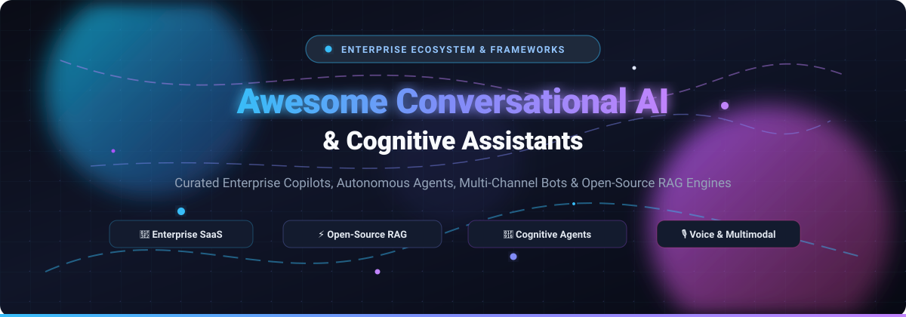

# 🤖 Awesome Conversational AI & Cognitive Assistant Ecosystem 🧠

  <strong>A curated directory of enterprise cognitive assistants, multi-channel dialogue bots, autonomous AI agents, and production-grade open-source RAG engines.</strong>

  
  
  
  
  
  

  <em>Search Keywords: Conversational AI, Cognitive Assistant, Enterprise Copilot, LLM Agent, RAG Pipeline, Chatbot Framework, Dialogue Management, Voice AI, Self-Hosted Assistant, AI Customer Support.</em>

---

## 📑 Table of Contents
- [🌐 Sector Overview & Market Dynamics](#-sector-overview--market-dynamics)
- [🏢 SaaS & Hosted Enterprise Platforms](#-saas--hosted-enterprise-platforms)
- [⚡ Open-Source GitHub Projects](#-open-source-github-projects)
- [🤝 How to Contribute](#-how-to-contribute)
- [💖 Support & Sponsorship](#-support--sponsorship)
- [📈 Star History](#-star-history)
- [⚖️ Disclaimer](#️-disclaimer)

---

## 🌐 Sector Overview & Market Dynamics

The global conversational AI and cognitive assistant market is valued at **$14B–$17B in 2025** and projected to exceed **$20B–$24B by 2026**, expanding at a robust compound annual growth rate (**CAGR of 20–25%**).

The ecosystem is characterized by a **two-tier market structure**:
1. **Infrastructure & Foundational Model Layer (Highly Concentrated / Oligopolistic):** Dominated by hyperscale cloud and foundation-model providers (Microsoft, Google Alphabet, OpenAI, IBM) who control core model training, enterprise inference scale, and operating system / productivity suite integration.
2. **Application & Orchestration Layer (Moderately to Highly Fragmented):** A dynamic landscape of domain-specific copilots, vertical contact-center agents, and open-source self-hosted RAG frameworks (such as Dify, Open WebUI, RAGFlow, and Flowise) competing fiercely on data residency, privacy sovereignty, customizable orchestration, and on-premises extensibility.

---

## 🏢 SaaS & Hosted Enterprise Platforms

| Product | Description | Company Size (Valuation / Revenue) | Pricing (Starting) | Free Tier / Trial Limits |
|---------|-------------|------------------------------------|-------------------|--------------------------|
| **[Microsoft Copilot](https://www.microsoft.com/en-us/microsoft-copilot)** | 💼 Enterprise AI assistant integrated across Microsoft 365 (Word, Excel, Teams, Outlook) and Windows. Grounded in organizational data via Microsoft Graph. | ~$3.9 Trillion (Market Cap) / $245B+ ARR | $21/user/month (SMB Business plan, billed annually) or $30/user/month (Enterprise add-on) | **30-day free trial** for qualifying Microsoft 365 business tenants; free standalone consumer Copilot Chat with basic daily limits |
| **[Google Gemini Enterprise](https://cloud.google.com/gemini)** | 🌐 Enterprise AI assistant integrated with Google Workspace and Google Cloud. Grounded in organizational data, with Vertex AI model garden access. | ~$3.6 Trillion (Alphabet Market Cap) / $350B+ ARR | $21/user/month (Business edition, annual commitment) or $30/user/month (Standard edition) | **30-day free trial** via Google Cloud console / Workspace admin; standalone Gemini consumer free tier available |
| **[OpenAI ChatGPT Enterprise](https://openai.com/enterprise)** | 💬 Enterprise-grade ChatGPT with advanced security, admin controls, unlimited high-speed GPT access, and data analysis. Does not train on business data. | ~$500 Billion – $852B+ (Private Valuation) / $10B+ ARR | $20/user/month (ChatGPT Business/Team, annual, 2-seat min) or ~$60/user/month (Enterprise tier custom contract, ~150-seat min) | **Free forever plan** available for individuals (standard model access, rate limited); no trial for Enterprise/Business |
| **[IBM watsonx Assistant](https://www.ibm.com/products/watsonx-assistant)** | 🤖 Enterprise conversational AI platform for building AI assistants across channels. Includes intent recognition, dialog management, and deep system integrations. | ~$235 Billion (Market Cap) / $62B+ ARR | $140/month (Plus plan, includes first 1,000 monthly active users and baseline resource units) | **Free forever (Lite plan)**: up to 1,000 unique monthly active users (10,000 API calls/month, 5 skills, 30-day inactivity expiration) |
| **[Zoho Zia](https://www.zoho.com/zia/)** | 📊 AI assistant embedded across Zoho applications. Includes predictive analytics, voice assistant, and workflow automation within the Zoho ecosystem. | ~$8 Billion – $12 Billion (Estimated Private Valuation) / $1.4B+ ARR | $40/user/month (Zoho CRM Enterprise tier, billed annually, unlocks native Zia AI capabilities) | **15-day free trial** of Enterprise edition (full Zia features unlocked, no credit card required); Free plan available for 3 users (excludes Zia AI) |
| **[Aisera](https://aisera.com/)** | 🛠️ AI service management platform with conversational AI for IT, HR, and customer service. Grounded in enterprise knowledge bases. Acquired by Automation Anywhere. | ~$1.5 Billion – $6.8 Billion (Automation Anywhere Valuation) | ~$7,500/month ($90,000/year minimum entry-level contract via cloud marketplace private offer) | **No self-serve free tier**; 30-day sales-guided Proof of Concept (PoC) sandbox available upon enterprise qualification |
| **[Amelia](https://amelia.ai/)** | 🗣️ Enterprise AI assistant (IPsoft) for IT operations, customer service, and HR. Positioned for large-scale automation with natural language understanding. Acquired by SoundHound AI. | ~$1.7 Billion (SoundHound AI Market Cap; $80M acquisition price) | ~$4,000/month (Estimated entry contract floor for high-volume voice/digital interaction channels) | **No self-serve free tier**; 30-day guided enterprise Proof of Concept (PoC) upon request |
| **[Kore.ai](https://kore.ai/)** | 🔄 Enterprise conversational AI platform for building, deploying, and managing AI assistants across voice and digital channels with contact center automation. | ~$1.0 Billion (Private Valuation) / $230M+ funding | $100 minimum usage/reload purchase (pay-as-you-go self-serve tier once promotional credits expire) | **$500 free credit trial** valid for 90 days on standard self-serve platform; permanent free developer sandbox for building and testing |
| **[Yellow.ai](https://yellow.ai/)** | 🎯 Conversational AI platform for customer support automation across voice and chat. Includes autonomous AI agents, campaign orchestration, and analytics. | ~$550 Million (Valuation / SPAC merger) / $102M funding | $0.99 per resolution overage (after free tier) or custom enterprise contracts (~$1,500+/month) | **Free forever plan**: up to 1 AI agent, 500 chat sessions/month, and 2 human agent seats; no time-limited trial needed |

---

## ⚡ Open-Source GitHub Projects

Explore the top community-driven, self-hosted, and transparent conversational AI ecosystems. Projects are ranked by GitHub star popularity (descending):

| Project | GitHub_Stars | Description | Primary Tech Stack |
|---------|--------------|-------------|--------------------|
| **[Dify](https://github.com/langgenius/dify)** |  | 🚀 Production-ready LLM application development platform fusing conversational AI, visual prompt engineering, multi-agent orchestration, and native RAG workflows. | Python, TypeScript, React |
| **[Open WebUI](https://github.com/open-webui/open-webui)** |  | 💻 Feature-rich, user-friendly, and self-hosted AI interface for Ollama, OpenAI-compatible APIs, and local LLMs with built-in RAG, role-based access, and voice support. | Python, Svelte, TailwindCSS |
| **[RAGFlow](https://github.com/infiniflow/ragflow)** |  | 📑 Leading open-source RAG engine fusing retrieval-augmented generation with cognitive agent capabilities. Deep document understanding across complex unstructured data formats. | Python, C++, Docker |
| **[Flowise](https://github.com/FlowiseAI/Flowise)** |  | 🧩 Open-source drag-and-drop UI to build customized LLM conversational flows, cognitive assistants, agents, and multi-step reasoning pipelines using LangChain and LlamaIndex. | TypeScript, React, Node.js |
| **[LibreChat](https://github.com/LibreChat-AI/LibreChat)** |  | 🌟 Enhanced open-source AI chat platform supporting multi-provider AI agents (OpenAI, Anthropic Claude, Gemini, Ollama), code artifacts, multimodal inputs, and custom agent plugins. | JavaScript, TypeScript, Node.js |
| **[Chatwoot](https://github.com/chatwoot/chatwoot)** |  | 💬 Open-source omnichannel customer engagement platform for conversational bots, live-agent handoff, and messaging integrations across WhatsApp, Twitter, and website chat. | Ruby on Rails, Vue.js |
| **[Khoj](https://github.com/khoj-ai/khoj)** |  | 🧠 Self-hostable personal cognitive assistant and second brain that searches and converses across local notes, documents, images, and online sources. | Python, TypeScript, FastHTML |
| **[Rasa](https://github.com/RasaHQ/rasa)** |  | 🤖 Established conversational AI framework for enterprise dialog management, intent classification, and CALM (Conversational AI with Language Models) business automation. | Python |
| **[DB-GPT](https://github.com/eosphoros-ai/DB-GPT)** |  | 🗄️ Multi-agent cognitive assistant and framework grounded in private databases, text-to-SQL workflows, and multi-source data retrieval with strict privacy guarantees. | Python |
| **[Leon](https://github.com/leon-ai/leon)** |  | 🏠 Open-source personal conversational assistant that runs securely on your own hardware, supporting custom modules, voice interactions, and local scheduling. | TypeScript, Python, Node.js |
| **[Pipecat](https://github.com/pipecat-ai/pipecat)** |  | 🎙️ High-performance, open-source framework for building real-time voice and multimodal conversational AI agents with sub-250ms latency via WebRTC. | Python |
| **[Botpress](https://github.com/botpress/botpress)** |  | ⚡ Developer-first conversational bot building platform with modular architecture, visual flow automation, and multi-channel deployment connectors. | TypeScript, Node.js |

---

### 🛠️ Specialized Local & Knowledge-Graph RAG Suites
- **[IntelligenceSuite](https://pypi.org/project/intelligence-suite/)**: Python-based local RAG suite with CodeIntelligence, DocIntelligence, and MentorIntelligence modules. Runs locally on Ollama with ChromaDB; OpenAI-compatible gateway for OpenWebUI/LibreChat integration with zero cloud dependency.
- **[Flexible GraphRAG](https://pypi.org/project/flexible-graphrag/)**: Open-source context platform combining document parsing (Docling/LlamaParse), automatic knowledge graph construction, hybrid semantic search (vector + RDF/SPARQL), and chat reasoning.

---

## 🤝 How to Contribute

Contributions are welcome! Help keep this ecosystem comprehensive, accurate, and up-to-date:

1. 🍴 **Fork the repository**.
2. 🌿 **Create a new branch** (`git checkout -b feature/add-new-assistant`).
3. 📝 **Add or update entries** in `README.md` adhering to the existing markdown table format (ensure pricing, trial limits, and official GitHub Stars_Badges are properly linked).
4. 🚀 **Submit a Pull Request** with a concise description of the tool and its utility to the community.

---

## 💖 Support & Sponsorship

If you found this curated list helpful for your research, team, or personal projects:
- ⭐ **Star this repository** to help others discover it!
- 🍴 **Fork & Share** it with colleagues, developers, and AI engineers.
- ☕ **Buy me a coffee / Sponsor**: If you'd like to support ongoing maintenance and new ecosystem curations, consider sponsoring via the **[GitHub Sponsor Dashboard](https://github.com/sponsors/ishandutta2007)**. Thank you for your generosity!

---

##  Star History

---

## ⚖️ Disclaimer

- This repository is a **community-curated, open-source directory** intended for educational, research, and technical comparison purposes.
- Mentions of commercial brands, enterprise platforms, and logos belong to their respective trademark holders and do not constitute an official endorsement.
- Conversational AI systems handle confidential enterprise data and customer communications. Always conduct independent security, privacy, and regulatory audits before production deployments.

---

  Built with ❤️ for AI Engineers, Dialogue Designers, and Cognitive System Architects.

